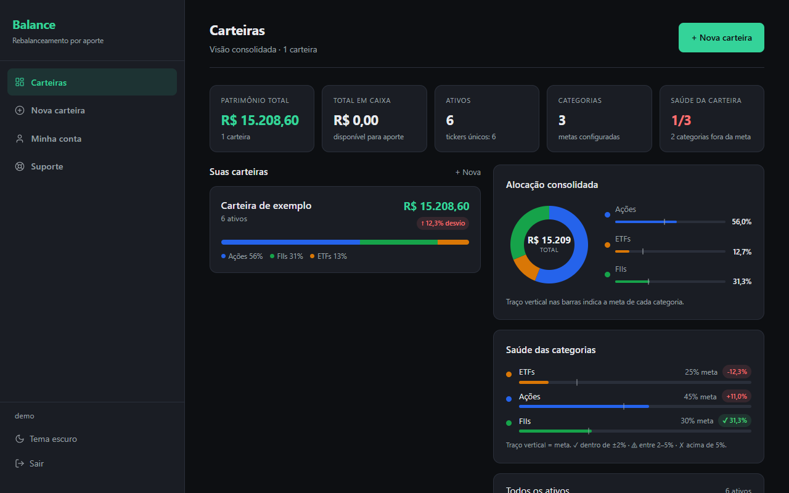
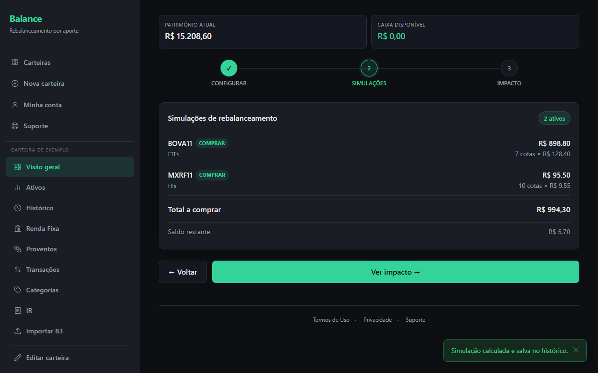
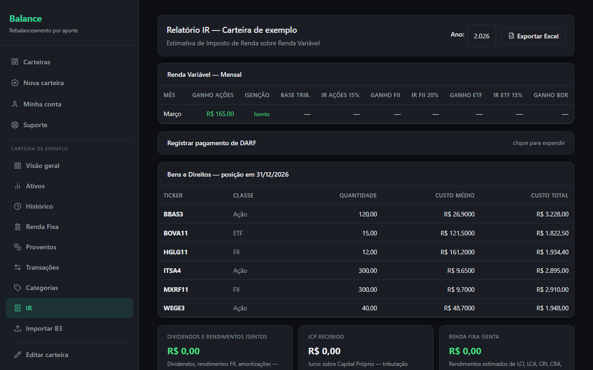
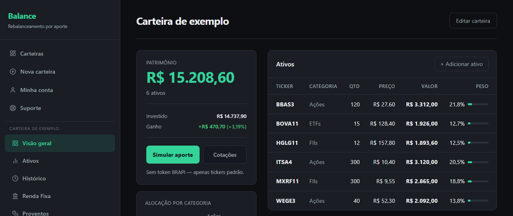

# Balance

Um app web para quem investe todo mês e quer calcular como aproximar a carteira das metas usando o próximo aporte.

[Acesse o Balance](https://balanceinvest.app)

## Telas

As capturas serão adicionadas pelo responsável pelo projeto conforme as [instruções de screenshots](screenshots/README.md).

### Painel consolidado

### Simulação de rebalanceamento

### Imposto de renda

### Importação da B3

### Carteira

## O que faz

O Balance responde à pergunta: “Tenho X hoje; o que compro para a carteira chegar mais perto das metas?”. O cálculo usa a carteira cadastrada, os preços atuais e as metas por categoria. O app não executa ordens nem recomenda ativos.

- **Carteiras em três mercados:** Brasil, EUA e cripto, com painel consolidado e conversão por câmbio.
- **Cotações automáticas:** busca em várias fontes em sequência, com cache para manter a consulta disponível quando as fontes falham.
- **Metas por categoria:** os percentuais precisam somar 100%.
- **Rebalanceamento:** simulação de compras com o aporte e, opcionalmente, vendas do que excedeu a meta, evitando as que gerariam imposto.
- **Renda fixa:** vários aportes por investimento e indexadores CDI, Selic, IPCA+ e prefixado.
- **Histórico financeiro:** proventos e transações com cálculo de custo médio.
- **Impostos no Brasil:** ganhos mensais, DARF estimado, bens e direitos e exportação em planilha.
- **Outros mercados:** ganho de capital nos EUA por FIFO, distinguindo curto e longo prazo, e imposto sobre cripto.
- **Importação da B3:** leitura do extrato com tela de auditoria e sem duplicar registros.
- **Acesso:** tema claro e escuro, português e inglês e PWA instalável.

## Exemplo de simulação

Exemplo inteiramente fictício, com números e tickers inventados: uma carteira tem R$ 600 na categoria A, representada por `FICA3`, e R$ 400 na categoria B, representada por `FICB4`. A meta é 50% em cada categoria.

Com um aporte de R$ 200 e cotação fictícia de R$ 10 para `FICB4`, a simulação aloca o aporte em 20 unidades desse ativo. A carteira passa a ter R$ 600 em cada categoria, totalizando R$ 1.200 e atingindo a divisão de 50%/50%, sem vendas. Isso ilustra o cálculo a partir das metas cadastradas.

## Stack

| Camada | Tecnologia |
| --- | --- |
| Linguagem | Python 3.12 |
| Backend | Django 6 |
| Interface | Templates do Django com Tailwind CSS 4 |
| Banco de dados | PostgreSQL; SQLite em desenvolvimento |
| Execução | Gunicorn atrás do Nginx em uma VPS Linux |
| Arquivos estáticos | WhiteNoise |
| Testes | Mais de 300 testes com o `TestCase` do Django |

## Arquitetura

O navegador ou PWA acessa o Django por Nginx e Gunicorn. As views delegam os cálculos e as regras de negócio a serviços, e os dados são persistidos em PostgreSQL. As integrações externas são acessadas pelo servidor.

Veja o [diagrama e o fluxo da simulação de aporte](docs/architecture.md).

## Decisões de engenharia

1. **Precisão com `Decimal`.** Valores monetários e quantidades usam `Decimal`, com oito casas para cripto. Isso evita os erros de representação de ponto flutuante nos cálculos financeiros. O arredondamento é explícito e fica restrito à exibição ou ao fechamento, para não acumular diferenças durante as etapas intermediárias.
2. **Regras em serviços.** Rebalanceamento, imposto de renda, ganho de capital e importação ficam separados das views. Assim, as regras podem ser testadas sem HTTP e a apresentação não precisa carregar a lógica financeira.
3. **Cotações resilientes.** As fontes são consultadas em ordem, com timeout em cada chamada. Se todas falharem, o cache serve como alternativa: uma indisponibilidade externa não quebra a tela nem deixa a requisição esperando indefinidamente por uma fonte.
4. **Um motor para três mercados.** Brasil, EUA e cripto compartilham o motor de cálculo; moeda e regras de imposto variam por mercado. Isso mantém o algoritmo consistente e evita três implementações da mesma lógica.
5. **Proteção de acesso e transporte.** O limite de tentativas de login reduz tentativas repetidas de acesso; TOTP acrescenta uma segunda etapa para contas da equipe. A confirmação de e-mail verifica o controle do endereço, e o bloqueio de e-mail descartável dificulta cadastros efêmeros. Cabeçalhos de segurança e HTTPS atrás de proxy protegem a comunicação e orientam o comportamento do navegador.
6. **Pagamento verificável e idempotente.** A assinatura do webhook é conferida para validar a origem do evento. O checkout é idempotente para que clicar duas vezes não gere duas cobranças.
7. **Exclusão em duas etapas.** Uma conta excluída permanece em exclusão suave por 30 dias e depois é apagada definitivamente. A janela torna a exclusão inicialmente reversível e estabelece um prazo para a remoção dos dados no contexto da LGPD.

## Repositório aberto

O algoritmo de compra por aporte e o cálculo FIFO foram extraídos como uma biblioteca Python pura, permitindo apresentar essas regras sem expor o código do produto.

[rebalance-by-deposit](https://github.com/<usuario>/rebalance-by-deposit) — link placeholder, a ser substituído pelo endereço do repositório derivado.

## Artigos

- [Rebalanceando uma carteira sem vender nada: o algoritmo do aporte](https://medium.com/@diegocardoso117/rebalanceando-uma-carteira-sem-vender-nada-o-algoritmo-do-aporte-d3c2667f8dbc)
- [Rebalanceando a carteira só com o próximo aporte (sem vender)](https://medium.com/@diegocardoso117/rebalanceando-a-carteira-s%C3%B3-com-o-pr%C3%B3ximo-aporte-sem-vender-718315aa4a42)
- [Imposto de renda sobre ações como um service em Django](https://medium.com/@diegocardoso117/imposto-de-renda-sobre-a%C3%A7%C3%B5es-como-um-service-em-django-d9e1129b9566)

## Aviso

O Balance não é recomendação de investimento. Ele calcula simulações com base na carteira, nos preços e nas metas cadastradas; não recomenda ativos nem executa ordens.

## Por que o código é privado

O Balance é um produto em produção que lida com dados financeiros de pessoas. O código do app é privado; este repositório público apresenta o produto, a arquitetura e as decisões de engenharia, sem incluir o código da aplicação ou dados de usuários.

## English summary

Balance is a web app for monthly investors who want to calculate how a new deposit can bring their portfolio closer to category targets. It supports Brazilian, US, and crypto portfolios, automatic quotes, fixed income, dividends, transaction tracking, tax reports, and B3 statement imports. Built with Python, Django, PostgreSQL, and Django templates with Tailwind CSS, it keeps financial rules in testable services and uses decimal arithmetic for money and quantities. Balance does not recommend assets or execute orders. The production app is private; this public repository showcases its product and engineering, with deposit rebalancing and FIFO extracted into a pure Python library.
