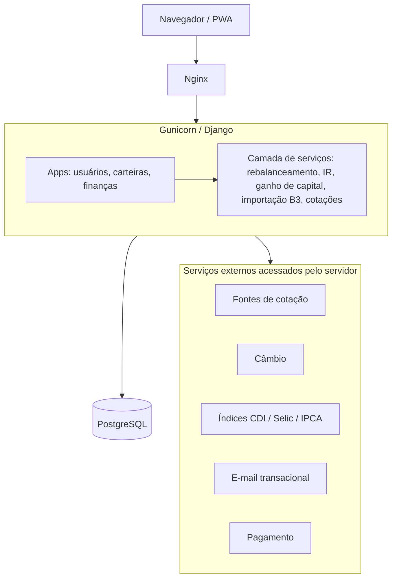

# Arquitetura

## Fluxo de uma simulação de aporte

1. O navegador ou PWA envia o valor do aporte e a opção de considerar vendas ao Django, passando por Nginx e Gunicorn.
2. A view recebe a solicitação e encaminha o cálculo ao serviço de rebalanceamento, separado do HTTP.
3. O serviço utiliza a carteira cadastrada, suas posições e as metas por categoria, que precisam somar 100%.
4. O cálculo usa os preços já atualizados da carteira. A atualização busca em fontes sequenciais com timeout e, se todas falharem, mantém o último preço em cache.
5. O motor calcula a distância até as metas e a distribuição do aporte usando `Decimal`, com oito casas para quantidades de cripto.
6. Se a opção de vendas estiver ativa, a simulação considera os excessos de alocação e evita vendas que gerariam imposto, conforme as regras do mercado.
7. O Django devolve a simulação para exibição, com arredondamento explícito nessa etapa; nenhuma ordem é executada.
